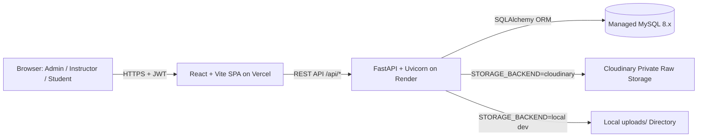
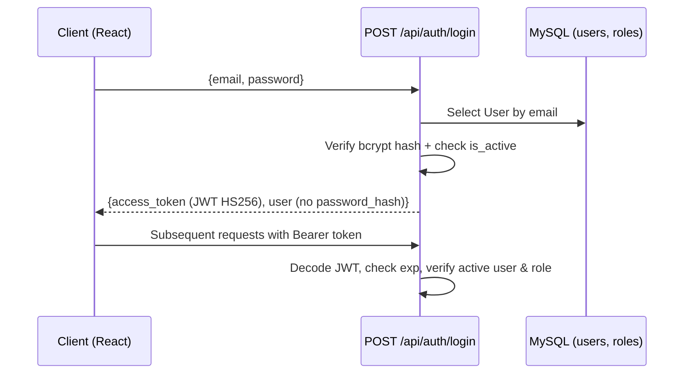

# System Architecture

- **Title:** LMS System Architecture
- **Version:** 1.0
- **Author:** LMS Engineering Team
- **Last Updated:** 2026-11-25

---

## 1. High-Level System Diagram

---

## 2. Request & Data Flow

1. **Frontend -> Backend:** The React SPA (`frontend/src/services/api.js`) sends JSON or `multipart/form-data` requests to `VITE_API_BASE_URL` with `Authorization: Bearer <jwt>`.
2. **Backend Middleware & Routing:** FastAPI applies `SlowAPIMiddleware` (rate limiting on auth), `CORSMiddleware` (`FRONTEND_ORIGIN`), and global exception handlers (`error_handler.py`) before dispatching to module routers (`backend/app/routers/`).
3. **Auth & RBAC Layer:** `get_current_user` decodes the HS256 JWT, loads the active `User` and `Role`, and `require_role([...])` enforces role gates. Service functions perform resource-level ownership/enrollment checks to block IDOR.
4. **Persistence Layer:** Services use SQLAlchemy 2.0 `Session` (`database.py`) for parameterized queries against MySQL (or SQLite in-memory during Pytest). Schema evolution is managed by Alembic (`backend/migrations/`).
5. **Storage Layer:** `storage_service.py` validates file extensions, size (`MAX_UPLOAD_SIZE_MB`), and magic bytes before delegating to `LocalStorageBackend` (dev) or `CloudinaryStorageBackend` (prod, `type=authenticated`). Private downloads are always proxied/authorized by backend endpoints.

---

## 3. Authentication Flow

---

## 4. Key Architectural Decisions

- **Router -> Service -> Model Separation:** Routers handle HTTP/Pydantic validation; services encapsulate transactions, RBAC resource checks, and business rules; models define constraints and relationships.
- **Server-Computed Academic & Financial State:** Late submission flags, quiz scores, timer expiry, attendance percentages, payment statuses, and certificate eligibility are never trusted from client payloads.
- **Environment-Swappable Storage:** `StorageBackend` protocol isolates file persistence so local dev requires no external credentials while production Render deployments avoid ephemeral disk loss.
